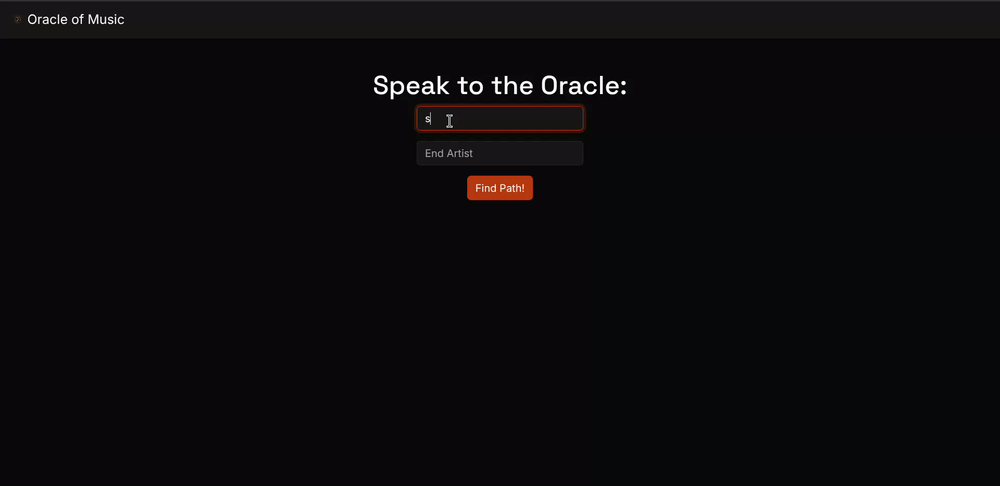
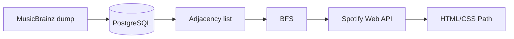

# Oracle of Music

Find the shortest chain of collaborations linking any two music artists, like the Oracle of Bacon (Six Degrees of Kevin Bacon), but for music.

**Live at [oracleofmusic.app](https://oracleofmusic.app/)**: currently covers the top 5,000 Spotify artists and everyone they've collaborated with.



**Built with:** Python · Flask · SQLAlchemy · PostgreSQL · Docker · Gunicorn · Nginx · vanilla JS/HTML/CSS · MusicBrainz · Spotify Web API

## How it works



- **Self-hosted data:** a PostgreSQL database built from the full MusicBrainz data dump, running in Docker.
- **Clean collaborations only:** tracks are filtered to official albums, singles and EPs, excluding bootlegs and unofficial releases.
- **Fast search:** collaborations are worked out once and cached in the database, then searched in memory with breadth-first search, so each Path is the shortest one possible.
- **Lazy Spotify data:** artist pictures, album art and Spotify links load after the Path is shown, one request per item.
- **Typeahead search:** accent-insensitive artist suggestions that also match alternative names.
- **Accessible Path display:** keyboard-focusable, respects reduced-motion settings, and switches to a vertical layout on narrow screens.


## Running locally

### Prerequisites

- Python 3.13+
- Docker
- About 40 GB of free disk space for the database
- A [Spotify developer app](https://developer.spotify.com/dashboard) (client ID and secret)

### 1. Build the database

Follow [deploy_database/instructions.txt](deploy_database/instructions.txt) to start PostgreSQL in Docker and load the [MusicBrainz data dump](https://metabrainz.org/datasets/download) into it.

### 2. Configure the app

Create a `.env` file in the repo root:

| Variable | Description |
| --- | --- |
| `DATABASE_URL` | SQLAlchemy URL for the MusicBrainz database, e.g. `postgresql+psycopg://postgres:<password>@localhost:5432/musicbrainz` |
| `SPOTIFY_CLIENT_ID` | Spotify app client ID |
| `SPOTIFY_CLIENT_SECRET` | Spotify app client secret |
| `ARTIST_NAMES_FILE_PATH` | Text file with one artist name per line, most important first |
| `ARTISTS_TO_LOAD` | How many names to read from that file. The app finds Paths between these artists and everyone they've collaborated with. The live site uses the top 5,000 Spotify artists. |

### 3. Install and run

```sh
python -m venv .venv
source .venv/bin/activate
pip install -r requirements.txt

cd app
gunicorn app:app        # or: flask --app app run
```

The first start builds the collaboration graph and caches it in the database. Later starts reuse the cache.

### Tests

The tests don't need a database or Spotify credentials:

```sh
pytest
```

## Acknowledgements

- [MusicBrainz](https://musicbrainz.org/) for the artist and track data
- [Spotify Web API](https://developer.spotify.com/documentation/web-api) for artist pictures, album art and links
- [mbdata](https://github.com/metabrainz/mbdata), which the database build scripts are adapted from

## License

[MIT](LICENSE)
